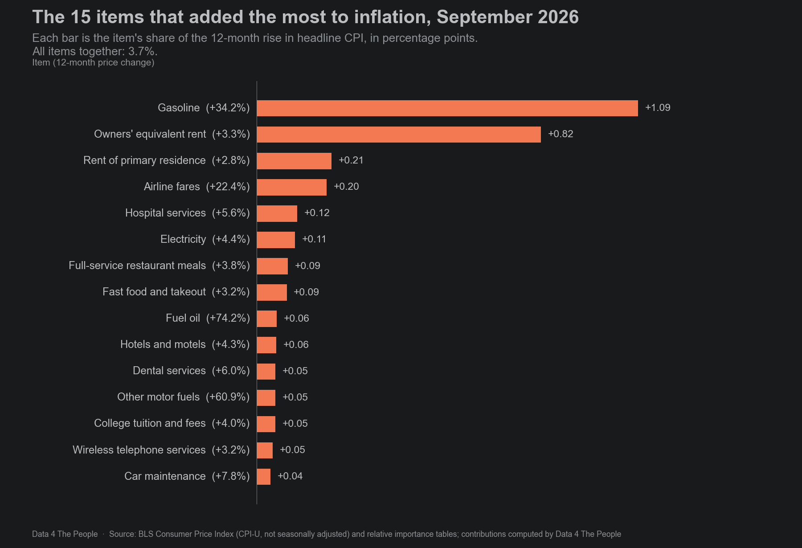
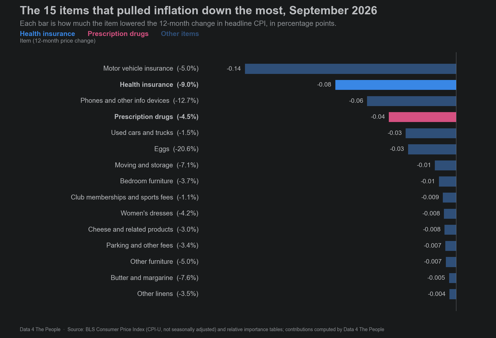

---
title:
subtitle:
slug: cpi-september-2026
date: 2026-10-15
section: Data 4 Thought
hero: images/cpi-september-2026-hero-1680x1080.png
hero_alt:
meta_title:
description:
keywords:
schema_type: article
drop_cap: true
heading_spacer: 20px
caption_spacer: 20px
dividers: false
---

# Title

Yesterday, the Bureau of Labor Statistics released the Consumer Price Index (CPI) for September 2026. This is “the inflation report” that all eyes are on to understand the consumer’s experience of inflation.

For the new D4TP readers, I will briefly indoctrinate you into my views on CPI – it reflects no one’s experience of inflation. We [illustrated this](https://www.data4thepeople.com/p/gasoline-share-of-income) three weeks ago using gasoline costs. It is very much worth reading before attributing much meaning to CPI as a proxy for the inflation real people feel.

But, alas, so many people think CPI is real, that it has become a very real and important concept. And so, we can’t just dismiss this data. We can simultaneously understand that CPI is not inflation that you and I feel, but it is still extremely important.

That said, we created a new tool to display CPI over time. We’re quite excited about this new tool, because we were able to work a fitting double entendre into the visualization itself. We have displayed CPI itself as a hot air balloon, with the air lifting the balloon up (items with year-over-year inflation), and the ballast pulling it down (items with year-over-year deflation). The items are sized by how much they added to the CPI number, and you can switch between “core” CPI and “headline” CPI (core being another fabricated concept, in our view, but one that many people care about).

And the other meaning of the double entendre? This data, in our view, is largely just hot air.

<iframe src="https://data4thepeople.github.io/CPI_analysis/dist/over-time.html" width="100%" height="780" frameborder="0" scrolling="no" title="The CPI Hot Air Balloon"></iframe>
::: spacer 40px

## How to read the balloon

Each box in the balloon is one item in the CPI, such as gasoline, rent or airline fares. There are 204 of them, the most detailed items BLS publishes weights for. The size of a box is how much that item added to the 12-month inflation rate, in percentage points. Its color is how much the item's own price changed over those 12 months, from blue (prices fell) to red (prices rose).

Items whose prices fell hang below the basket as sandbags, sized the same way. The top of the basket sits at that month's inflation rate on the scale at the left, and the dashed green line marks the Federal Reserve's 2% target.

How to use it:

- Press **Play** to run through every month from October 2016 to September 2026. **1x**, **2x** and **5x** set the speed.
- Click or drag on the timeline under the balloon to jump to a month. The arrow keys step one month at a time.
- **All items** shows headline CPI. **Core** shows core CPI, which leaves out food and energy.
- **Table** shows the same numbers as a list, which is easier to read on a phone.
- Hover over a box to see the item's share of spending, its price change and how much it added.

There is no October 2025. BLS did not publish it during the federal funding lapse, so the balloon skips from September to November 2025.

The data comes from the Bureau of Labor Statistics: the monthly price index for each item, and each item's share of consumer spending, which BLS calls its relative importance. Our code, our data and the full method are on GitHub. The [README](https://github.com/Data4ThePeople/CPI_analysis#readme) is the place to start, and [DATASETS.md](https://github.com/Data4ThePeople/CPI_analysis/blob/main/DATASETS.md) explains every source and its limits.

### Do the pieces add up?

A breakdown like this is only useful if the pieces add back up to the number BLS publishes. We checked every month, for both headline and core. The chart below compares the 12-month rate BLS publishes (the line) with the sum of our 204 items (the dots).

*Source: BLS CPI-U, U.S. city average, not seasonally adjusted; item contributions computed by Data 4 The People.*

In every month, our items add up to within 0.0013 percentage points of the published rate. That is far smaller than the 0.1 point BLS rounds to, and every month matches the rate BLS reports at one decimal. Every check we ran, with the numbers, is in [TIEOUT.md](https://github.com/Data4ThePeople/CPI_analysis/blob/main/TIEOUT.md).

## September 2026: what moved inflation

In September 2026, headline CPI was 3.7% higher than a year earlier, and core CPI was up 2.6%. The chart below starts at zero and adds the six items that pushed inflation up the most, then the other 194 items together, then the four items that pulled it down the most.

*Each bar is the item's contribution to the 12-month change in headline CPI, in percentage points. Source: BLS; contributions computed by Data 4 The People.*

Gasoline added the most. Its price was 34.2% higher than a year earlier. Gasoline is about 3% of consumer spending in the CPI, but it added 1.09 of the 3.74 points, or 29% of the increase.

Housing came next. Owners' equivalent rent, which is BLS's estimate of what homeowners would pay to rent their own home, added 0.82 points, and rent added 0.21. Counting hotels and other lodging, shelter added 1.14 points, or 31% of the increase.

Taken as groups, energy (gasoline, electricity, fuel oil, natural gas and other fuels) added 1.35 points, or 36% of the increase. Food added 0.34 points, or 9%. Everything else, the items that make up core CPI, added 2.05 points, or 55%.

Four items pulled the rate down the most. Motor vehicle insurance fell 5.0% and took 0.14 points off. Health insurance fell 9.0% (0.08 points), phones and similar devices fell 12.7% (0.06 points), and prescription drugs fell 4.5% (0.04 points).

Core CPI tells a similar story without food and energy. The chart below builds up core the same way. Because core leaves out food and energy, each remaining item is a larger share of the total, so its contribution in points is larger than in the headline chart.

*Each bar is the item's contribution to the 12-month change in core CPI (less food and energy), in percentage points. Source: BLS; contributions computed by Data 4 The People.*

Shelter added 1.43 of the 2.56 points, or 56% of core inflation. Owners' equivalent rent alone added 1.02 points. The same four items pulled core down the most: motor vehicle insurance (0.17 points), health insurance (0.10), phones and similar devices (0.07) and prescription drugs (0.05).

### The prices that rose the fastest

The waterfall shows which items moved the total. A different question is which prices rose the fastest, whatever their size. The first slide below shows the 15 items with the largest 12-month price increases. The next two show the 15 items that added the most to inflation and the 15 that pulled it down the most.

::: carousel

*12-month price change, September 2026. Only items with their own published BLS index. Source: BLS.*

*Contribution to the 12-month change in headline CPI, in percentage points. Source: BLS; contributions computed by Data 4 The People.*

*Contribution to the 12-month change in headline CPI, in percentage points. Source: BLS; contributions computed by Data 4 The People.*
:::

Energy tops the list. Fuel oil rose 74.2% and other motor fuels rose 60.9%, but each is less than 0.1% of spending, so together they added about 0.11 points. Gasoline rose less, 34.2%, but it is a much larger share of spending, so it moved the total far more.

Outside energy, airline fares rose 22.4% and added 0.20 points. Several other fast risers, such as computer software, delivery services, newspapers and magazines, and postage, are very small shares of spending. Each moved the total by less than 0.01 point.

## Health insurance and prescription drugs

Two medical items pulled inflation down in September: health insurance, down 9.0% from a year earlier, and prescription drugs, down 4.5%. Both are well below their usual pace. The chart below shows each item's 12-month change since 2015, with its 10-year average as a dashed line.

*The 10-year average is the mean of the September-to-September changes from 2015-16 through 2024-25. Source: BLS.*

Over those 10 years, health insurance rose an average of 3.55% a year and prescription drugs 1.71% a year.

We have written before about [how the CPI measures health insurance](https://www.data4thepeople.com/p/cpi-merry-go-round), so we won't repeat it here. But look: health insurance down 9.0% and prescription drugs down 4.5% over the past year. How do these numbers jibe with your experience?

### What if they had risen at their usual pace?

To see how much these two items moved the September numbers, we swapped each one's actual 12-month change for its 10-year average and left every other item as published. The chart below compares the result with the published rates.

*What-if: health insurance at +3.55% and prescription drugs at +1.71%, all other items as published. Source: BLS; calculation by Data 4 The People.*

Headline CPI would have been 3.91% instead of 3.74%, and core would have been 2.78% instead of 2.56%. Rounded the way BLS reports it, headline would be 3.9% rather than 3.7%, and core 2.8% rather than 2.6%. Health insurance accounts for 0.11 points of the headline difference and prescription drugs for 0.06. For core, the two account for 0.14 and 0.08 points.

This is a simple swap, not a forecast. It shows how much these two items held down the September numbers. It does not say what their prices would have done.

## In conclusion…

Enjoy your analysis of the hot air. We’ll update this each month when BLS releases the CPI.

::: divider

## How we built this, and its limits

**Data.** The price index for each item is the CPI for All Urban Consumers (CPI-U), U.S. city average, not seasonally adjusted, from the BLS API. Each item's share of spending comes from the relative importance tables BLS publishes each December.

**Method.** An item's contribution is its share of spending times its price change. BLS updates the shares every January, so we split each 12-month period at that update and use the right shares on each side. That is why our items add up to the published rate. [DATASETS.md](https://github.com/Data4ThePeople/CPI_analysis/blob/main/DATASETS.md) has the full method.

**Items without their own index.** Not every item has a published price index every month. In September 2026, 29 of the 204 items, 4.2% of spending, did not. For those we used the part of their parent category's change that the parent's other items do not explain. That share was highest in November 2025, at 8.3%, when BLS resumed collecting prices after the funding lapse. Price changes for these small, filled items are less reliable than for items with their own index.

**Precision.** A single item's price change is measured less precisely than the total. BLS publishes estimates of this sampling error, which we have not used here.

**Health insurance.** BLS changed how it measures health insurance during these 10 years, so its 10-year average mixes two methods.

**What this does not tell you.** A contribution shows how much an item moved the published number. It does not explain why its price changed. The shares of spending are averages across urban consumers, so the mix of items in any one household's budget can look very different.
